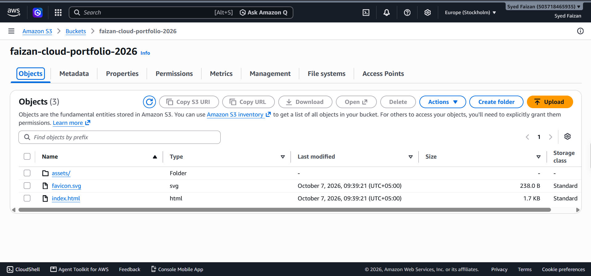
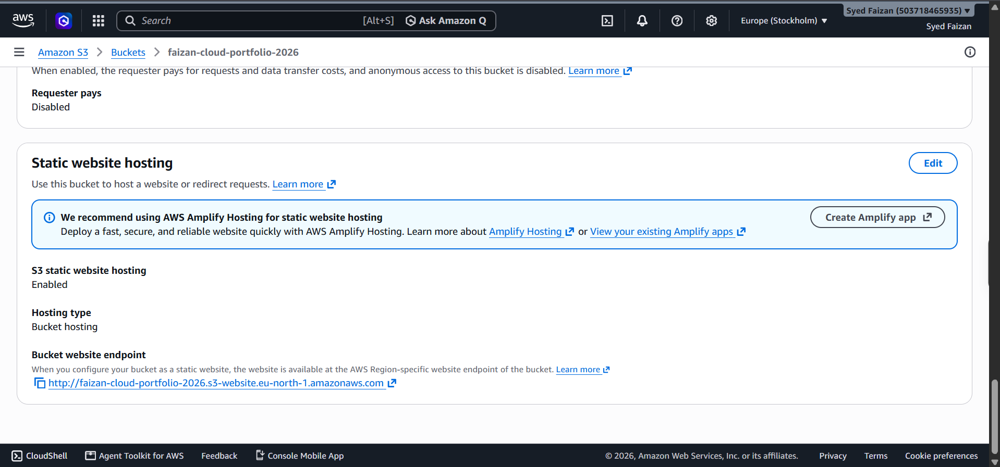
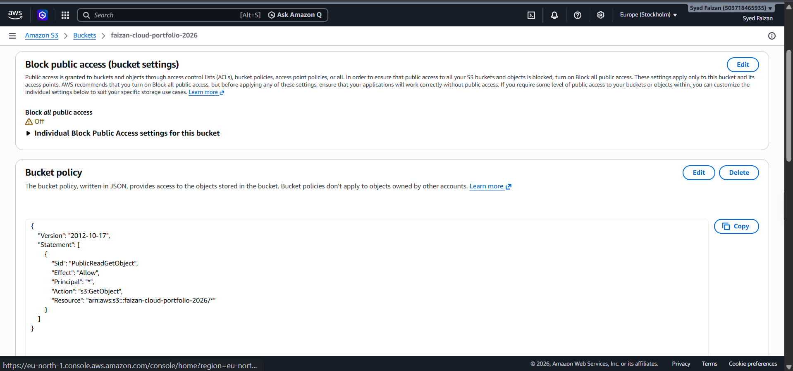

# Project 1: Static Portfolio Hosting on AWS S3

## Overview

As part of my Cloud Computing Internship at DecodeLabs, I deployed my personal portfolio website using **Amazon Web Services (AWS) S3 Static Website Hosting**.

The goal of this project was to understand how static websites can be hosted in the cloud and made publicly accessible without managing a traditional web server.

## Project Objectives

- Deploy a static portfolio website to Amazon S3.
- Configure an S3 bucket for static website hosting.
- Configure permissions to allow public access to website content.
- Understand S3 bucket policies and website endpoints.
- Validate the deployment through a browser.

## Technologies Used

- **Cloud Platform:** Amazon Web Services (AWS)
- **Storage Service:** Amazon S3
- **Frontend:** React / Vite
- **Deployment Type:** Static Website Hosting

## Implementation Steps

1. Created an S3 bucket for the portfolio website.
2. Built the frontend application and prepared the production files.
3. Uploaded the production build files to the S3 bucket.
4. Enabled static website hosting.
5. Configured the necessary bucket permissions and public-read policy.
6. Accessed the website through the S3 website endpoint and verified the deployment.

## Live Demo

**Website:** http://faizan-cloud-portfolio-2026.s3-website.eu-north-1.amazonaws.com/

## Screenshots

## Key Learnings

- Understanding Amazon S3 and cloud-based static website hosting.
- Deploying a frontend production build to a cloud storage service.
- Configuring bucket policies and public access.
- Understanding the difference between object storage and traditional web servers.
- Verifying a cloud deployment using a public website endpoint.

## Future Improvements

- Configure HTTPS using Amazon CloudFront.
- Connect a custom domain.
- Explore improved access controls and deployment automation.

## Acknowledgement

This project was completed as part of my Cloud Computing Internship at **DecodeLabs**, helping me gain practical experience with AWS cloud deployment.

#AWS #AmazonS3 #CloudComputing #AWSProjects #DecodeLabs #LearningByDoing
